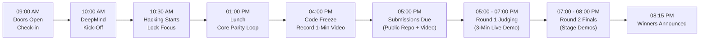

# 🗓️ Plan 01: Hackathon Agenda, Rules & Live Demo Script

> **Event:** Cerebral Valley × Google DeepMind — Gemini 4 Argon Hackathon  
> **Date:** Sunday, October 25, 2026 · **9:00 AM – 10:00 PM PT**  
> **Venue:** Shack15, Ferry Building, Suite 201, San Francisco, CA 94111  
> **Wi-Fi:** `SHACK15_Members` (Password: `M3mb3r$4L!f3`)  
> **Submission Deadline:** **5:00 PM PT** at `https://cerebralvalley.ai/e/gemini-4-argon-sf/hackathon/submit`  
> **Prizes:** USD 7,500 1st · USD 5,000 2nd · USD 2,500 3rd · **USD 5,000 Best Use of Managed Agents**

---

## 🧭 Master Schedule & Tactical Milestones



| Time | Official Milestone | Our Team Execution Focus |
| :--- | :--- | :--- |
| **9:00 AM – 10:00 AM** | Doors Open & Breakfast | Check in at Shack15 (Ferry Building 2nd Fl), join Discord (`#google-deepmind`), configure API keys and Antigravity SDK. |
| **10:00 AM – 10:30 AM** | Welcome & Keynote | Note any DeepMind announcements on model quotas, Long Decode limits, or Managed Agent sandbox specifics. |
| **10:30 AM – 1:00 PM** | Hackathon Sprint #1 | Ingest target AS/400 workload (DDS, RPGLE, DB2) in 1M window; build sandbox parity verification harness. |
| **1:00 PM – 4:00 PM** | Hackathon Sprint #2 | Build dual-mode React 19 UI (5250 CRT + modern view) + API backend; execute automated parity verification loop. |
| **4:00 PM – 5:00 PM** | Submission Polish | **Record 1-minute demo video**; ensure GitHub repo is **public**; verify all team members added to Cerebral Valley portal. |
| **5:00 PM** | **Submissions Due** | Hard deadline. Submit project link, video URL, and writeup. |
| **5:00 PM – 7:00 PM** | Round 1 Judging | 3-minute live product demo + 1-2 min Q&A in judging pods (50% live demo, 25% usefulness, 15% originality, 10% pitch). |
| **7:00 PM – 8:00 PM** | Final Round (Top 6) | Stage presentations before judges (Joana Carrasqueira, Shudhatma Jain, Subhasmita Sahoo, Oskar Yao). |
| **8:15 PM** | Awards Ceremony | USD 20,000 total prize purse announced. |

---

## 🚫 Disqualification Rules & Guidelines

> [!CAUTION] Mandatory Rules from Participant Guide
> - **Public GitHub Repo:** The repository must be public before 5:00 PM PT.
> - **Fresh Code:** All code demonstrated must be created during the hackathon.
> - **NO Slides Allowed:** Clarity of pitch requires demonstrating the working application in 3 minutes **without slides**.
> - **NO Streamlit & NO Dashboards as Main Feature:** Do not build a Streamlit wrapper or an app where a passive dashboard is the primary product. The tool must actively perform work.
> - **Avoid Generic Ideas:** No basic RAG, image summarizers, health/diet bots, or education chat apps.

---

## 🎤 The 3-Minute Live Judging Demo Script

```mermaid
sequenceDiagram
    autonumber
    actor Judge as Judging Pod
    actor Presenter as Team Demo Lead
    participant Terminal as AS/400 5250 Terminal
    participant Agent as Antigravity Managed Agent
    participant Modern as Modern Web & Parity Engine

    Presenter->>Judge: 0:00 - 0:25: Show 5250 green screen; demonstrate 72 keystrokes needed for one stock lookup
    Presenter->>Agent: 0:25 - 1:30: Trigger migration across DDS + RPG + DB2 via Gemini 4 Argon
    Agent-->>Modern: Ingests 1M context, generates React 19 + API, runs in sandbox
    Presenter->>Judge: 1:30 - 2:25: Show autonomous parity test suite comparing terminal states to modern API
    Presenter->>Judge: 2:25 - 3:00: Reveal measured improvement: 20x faster clerk velocity, 67.8x throughput, 100% parity
```

### Detailed Demo Script Segments

#### 1. Segment 1: The User Pain & Baseline (0:00 – 0:25)
- **What to show:** Open a genuine AS/400 `5250` green-screen terminal (Costco/warehouse inventory system).
- **Spoken script:**  
  *"Every day, millions of warehouse clerks and retail workers navigate 40-year-old green screens. To look up an item, check warehouse bin stock, and confirm reorder thresholds requires 72 keystrokes across 6 subfile screens, memorizing F3, F4, and F9. It takes 48 seconds and months of training. Here is what happens when we unleash Gemini 4 Argon and Antigravity Managed Agents on the real legacy source code."*

#### 2. Segment 2: Live Argon + Managed Agent Migration (0:25 – 1:30)
- **What to show:** Trigger the `as400-modernizer` Managed Agent (`antigravity-preview-09-2026` + `gemini-4-argon`).
- **Spoken script:**  
  *"We pass the entire repository—DDS display files, subfile controllers, RPGLE calculation specs, and DB2 physical tables—into Gemini 4 Argon's 1M context window. Unlike standard LLMs that hallucinate or drop files, Argon analyzes the entire indicator map (*IN03 through *IN99), extracts the exact validation rules, and generates a modern, keyboard-first React 19 application backed by a typed API and relational schema."*

#### 3. Segment 3: Autonomous Sandbox Verification & Safety Hook (1:30 – 2:25)
- **What to show:** Show the Google-hosted Antigravity Linux sandbox executing tests in the background. Show the `pre_tool_execution` safety hook in action.
- **Spoken script:**  
  *"Translation is only half the battle; verification is what matters. Inside Google's Antigravity sandbox, the Managed Agent executes an autonomous Golden Parity harness. It replays 200 real terminal transaction streams against the original logic, compares every database record change and output message, and asserts 100% parity before allowing cutover. Our pre_tool_execution hook blocks any destructive writes until safety constraints pass."*

#### 4. Segment 4: Measured Improvement Over Baseline (2:25 – 3:00)
- **What to show:** Side-by-side view: the green screen vs. the modern web app. Perform the same inventory reorder in 3 clicks.
- **Spoken script:**  
  *"Here is the result: The same warehouse operation dropped from 72 keystrokes and 48 seconds down to 3 clicks and 2.4 seconds—a 20x speedup for human workers. Backend transaction throughput jumped from 42 to 2,850 transactions per second, with 100.00% golden parity across all 200 test cases. Zero slides, zero guesswork—production-ready AS/400 modernization in minutes."*
