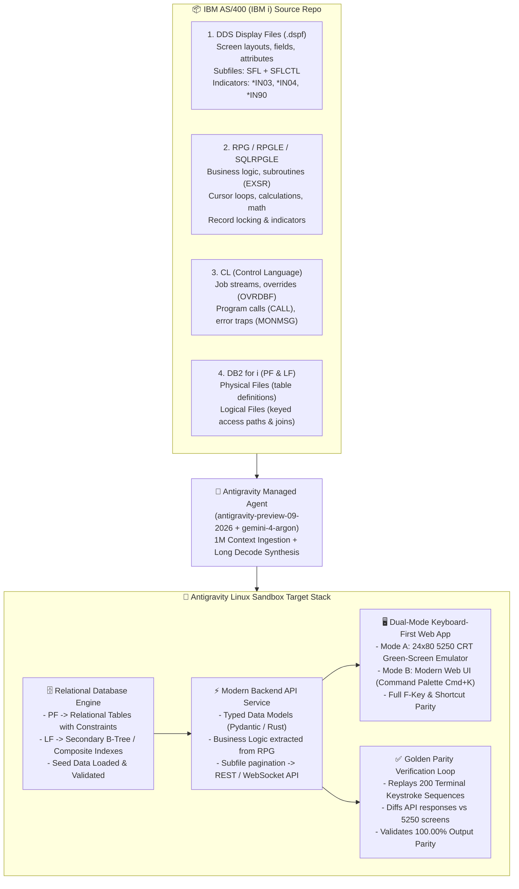
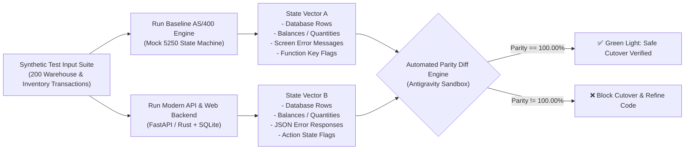

# 🏛️ Plan 02: AS/400 Modernization Architecture & Technical Blueprint

> **Event:** Gemini 4 Argon Hackathon  
> **Track:** Problem Statement #1 (*Million Token Engineering*)  
> **Source Platform:** IBM AS/400 (IBM i) — DDS Display Files, RPGLE, CL, DB2 for i  
> **Target Platform:** React 19 (Dual-Mode Keyboard UI) + Safe API (FastAPI/Rust) + PostgreSQL/SQLite

---

## 🏗️ End-to-End System Architecture

---

## 🔬 Deconstructing AS/400 Artifacts & Transformation Rules

### 1. DDS Display Files (`.dspf`) & Subfiles (`SFL` / `SFLCTL`)
- **How AS/400 Works:**  
  DDS display files define the 24×80 character grid of the IBM 5250 terminal. Lists and tables are handled by **Subfiles**:
  - `SFL` (Subfile Record): Defines the repeating row layout (e.g., item number, description, quantity).
  - `SFLCTL` (Subfile Control Record): Controls subfile display (`SFLDSP`), initialization (`SFLINZ`), clearing (`SFLCLR`), and pagination (`SFLPAG` vs `SFLSIZ`).
  - **Indicators (`*IN`):** Boolean flags (`*IN01` to `*IN99`) wired to function keys (`CF03` = F3 Exit, `CF04` = F4 Prompt, `CF12` = F12 Cancel) and field display attributes (e.g., `*IN40` triggers reverse image or red error text).
- **Modern Target Transformation:**  
  - Maps `SFL` to responsive React data grids / virtualized tables with inline cell editing.
  - Converts indicators into typed UI state (`uiState.isError`, `uiState.isExitRequested`, `uiState.isPromptActive`).
  - Implements keyboard event listeners capturing `F1`–`F12`, `Tab`, `Enter`, and `Cmd+K` so veteran terminal operators never touch the mouse unless they want to!

### 2. RPG, RPGLE & Free-Format RPG Business Logic
- **How AS/400 Works:**  
  RPG evolved from fixed-column punch-card specifications (`F` File, `D` Definition, `C` Calculation) to RPG IV / Free Format. Business rules feature:
  - Calculation loops (`DOW`, `DOU`, `FOR`), subroutine calls (`EXSR`), and indicator conditioning (`IF *IN03 = *ON`).
  - Embedded SQL (`EXEC SQL DECLARE c1 CURSOR FOR ...`).
  - Packed and zoned decimal arithmetic (`Z-ADD`, `MULT`, `DIV`, rounding flags).
- **Modern Target Transformation:**  
  - Gemini 4 Argon extracts pure domain business logic from calculation specs.
  - Rewrites calculations into clean, typed Python/FastAPI functions or safe Rust routines with exact decimal arithmetic (`rust_decimal` or `decimal.Decimal`).
  - Replaces global indicator mutations with clean, structured return objects and HTTP status codes.

### 3. Control Language (CL / CLP)
- **How AS/400 Works:**  
  CL scripts orchestrate jobs on IBM i:
  - `OVRDBF` (Override Database File): Dynamically redirects file access to test libraries or temporary members.
  - `CALL PGM(...) PARM(...)`: Invokes RPG modules with positional parameter buffers.
  - `MONMSG` (Monitor Message): Catches system exception messages (`CPF0000`, `CPF2817`).
- **Modern Target Transformation:**  
  - Translated into modular API route controllers and orchestration scripts.
  - Environment variables replace `OVRDBF`.
  - Structured `try/catch` and custom exception hierarchies replace `MONMSG`.

### 4. DB2 for i: Physical Files (`PF`) & Logical Files (`LF`)
- **How AS/400 Works:**  
  - **Physical Files (PF):** Fixed-length record format storing actual data rows with field-level data dictionary definitions (`A` specs).
  - **Logical Files (LF):** Views and indexes built over one or more physical files, defining alternative key access paths (e.g., look up customer by SSN vs account number) or select/omit criteria.
- **Modern Target Transformation:**  
  - PFs become relational tables with primary keys, typed columns, and check constraints (`migrations/001_initial.sql`).
  - LFs become relational `INDEX`es and SQL `VIEW`s, maintaining the exact same query efficiency without proprietary database hooks.

---

## 🔄 Dual-Execution Golden Parity Verification Loop

To guarantee that no business rule is broken during modernization:

1. **Transaction Inputs:** 200 randomized realistic operations (item lookup, bin transfers, inventory adjustments, purchase orders, reorder warnings).
2. **State Vectors Captured:**
   - Pre- and post-transaction database records.
   - Field validation error codes.
   - Inventory quantity and financial balance calculations.
3. **Verification Criterion:** `100.00%` equivalence on all outputs before deployment.
