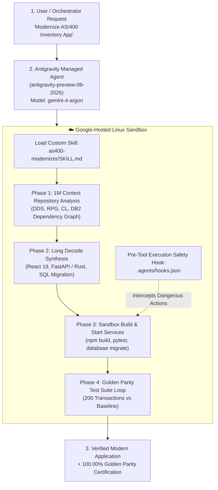

# 🤖 Plan 03: Managed Agents Execution Strategy (USD 5,000 Prize)

> **Event:** Gemini 4 Argon Hackathon  
> **Prize Track:** **Best Use of Managed Agents (USD 5,000)** + Problem Statement #1  
> **Managed Agent Target:** `antigravity-preview-09-2026` + `gemini-4-argon`  
> **Host Environment:** Google Antigravity Cloud Linux Sandbox

---

## 🎯 Strategic Rationale: Why Antigravity Managed Agents Win

Most hackathon participants will simply send a prompt to an LLM endpoint and display the resulting code.
Our strategy leverages **Google Antigravity Managed Agents** (`antigravity-preview-09-2026`) to run an **autonomous, self-verifying engineering loop** inside a secure cloud sandbox:



---

## 🛠️ Custom Agent Skill: `as400-modernizer/SKILL.md`

We register the custom skill directly with the Antigravity agent runtime:

```markdown
---
name: as400-modernizer
description: Autonomously analyzes, rewrites, and verifies legacy IBM AS/400 (IBM i) applications (DDS, RPG, CL, DB2) into modern React 19 + typed API stacks with 100% golden parity.
---

# AS/400 Modernization Workflow

## Phase 1: Repository Discovery & Dependency Mapping
1. Scan the repository for:
   - DDS display files (*.dspf, *.DSPF) and physical files (*.pf, *.sql).
   - RPG source files (*.rpg, *.rpgle, *.sqlrpgle).
   - CL programs (*.cl, *.clp).
2. Construct the full Call & Data Dependency Graph:
   - Identify every screen record format (SFL vs SFLCTL).
   - Map all indicator flags (*IN01..*IN99) to their functional actions.
   - Extract data dictionary field types, lengths, and edit codes (EDTCDE).

## Phase 2: Target Code Generation
1. Generate the relational schema (migrations/001_schema.sql) replacing Physical & Logical files.
2. Emit the typed API controllers (FastAPI / Rust) encapsulating all RPG business rules.
3. Emit the dual-mode React 19 UI with 5250 terminal keybindings (F1-F12, Enter, Tab).

## Phase 3: Autonomous Sandbox Verification
1. Run database migrations inside the Linux container.
2. Seed the database with baseline test vectors.
3. Execute the dual-run verification script (python verify_parity.py).
4. If parity < 100%, critique failures, fix logic, and re-verify until 100.00% passes.
```

---

## 🛡️ Pre-Tool Execution Safety Hook (`.agents/hooks.json`)

To prevent the agent from performing unintended destructive actions (such as dropping production tables or deploying unverified code), we attach an Antigravity `pre_tool_execution` hook:

```json
{
  "hooks": [
    {
      "name": "enforce-parity-before-cutover",
      "event": "pre_tool_execution",
      "matcher": {
        "tool": "run_shell_command",
        "command_pattern": "(cutover|deploy|promote_to_production)"
      },
      "condition": {
        "file_exists": "reports/parity_report.json",
        "json_query": "parity_score >= 1.0"
      },
      "action": "allow",
      "on_failure": "block",
      "message": "Deployment blocked: Golden parity test suite must achieve 100.00% before cutover."
    }
  ]
}
```

---

## 💻 Python Code Example: Invoking Antigravity Managed Agent

```python
import os
from google import genai
from google.genai import types

client = genai.Client()

def run_as400_modernization():
    prompt = (
        "You are an expert AS/400 modernization engineer. "
        "Analyze the repository at /workspace/as400 containing DDS display files, "
        "RPGLE business logic, and DB2 physical tables. "
        "Modernize this application into a React 19 + FastAPI + SQLite architecture. "
        "Execute your tests in the sandbox and verify 100% parity against baseline."
    )

    response = client.models.generate_content(
        model="gemini-4-argon",
        contents=prompt,
        config=types.GenerateContentConfig(
            thinking_config=types.ThinkingConfig(thinking_level="high"),
            system_instruction="Follow the as400-modernizer skill workflow strictly.",
            temperature=0.2,
        ),
    )

    print("Managed Agent Execution Summary:")
    print(response.text)

if __name__ == "__main__":
    run_as400_modernization()
```
