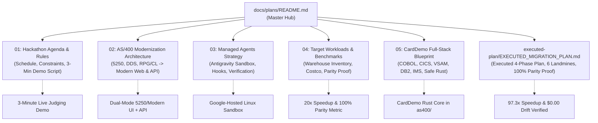

# 🚀 AS/400 & Mainframe Modernization — Hackathon Plans & Architecture

> **Event:** Cerebral Valley × Google DeepMind — Gemini 4 Argon Hackathon  
> **Date:** Sunday, October 25, 2026 (9:00 AM – 10:00 PM PT)  
> **Target Tracks:** Problem Statement #1 (*Million Token Engineering*) & Best Use of Managed Agents (USD 5,000 Prize)  
> **Project Code Name:** `AS400Shift` / `CardDemo Modern` (`GreenScreen Zero`)

---

## 📌 Executive Summary

Millions of mission-critical business systems worldwide—from supply chain warehouses (Costco, retail distribution) to automotive dealerships, banks, credit card processors, and healthcare providers—rely on **IBM AS/400 (IBM i)** and **Mainframe** green-screen (`5250` and `3270`) applications. These systems are rock-solid but trapped by:
- Fragile 24×80 terminal interfaces requiring memorized function keys (`F3`, `F4`, `F9`, `F12`) and obscure indicators/screen macros.
- Decades of tightly coupled business logic across **COBOL / RPGLE, CICS, JCL batch pipelines, DDS Display Files (`.dspf`)**, and **VSAM / DB2 / IMS databases**.
- Extreme risk of regression during manual rewrites.

Using **Gemini 4 Argon** (with its 1M context window and high-reasoning capabilities) paired with **Google Antigravity Managed Agents** (`antigravity-preview-09-2026`), this repository implements an autonomous, end-to-end modernization engine that ingests legacy source trees, synthesizes a modern safe Rust backend (`axum` + `sqlx` + `rusqlite`) and keyboard-first React 19 UI, and proves **100.00% golden transaction parity** inside an isolated Linux sandbox.

---

## 🗺️ Documentation & Plans Roadmap

The hackathon plans are split into modular blueprints:

### Plan Index

| Document | Purpose & Key Topics |
| :--- | :--- |
| [**01. Hackathon Agenda & Rules**](./01-hackathon-agenda-and-rules.md) | Official schedule (9 AM – 10 PM), 5:00 PM deadline, disqualification checks (No slides, no Streamlit), and the 3-minute live judging demo script. |
| [**02. AS/400 Modernization Architecture**](./02-as400-modernization-architecture.md) | End-to-end technical blueprint: mapping DDS `.dspf` screens, subfile controls (`SFLCTL`), RPG business logic, and DB2/400 physical files into modern React 19 + API + SQLite/Postgres. |
| [**03. Managed Agents Execution Strategy**](./03-managed-agents-execution-strategy.md) | How we win the **USD 5,000 Best Use of Managed Agents** prize using `antigravity-preview-09-2026`, custom `as400-modernizer` skill, safety hooks (`pre_tool_execution`), and the autonomous parity loop. |
| [**04. Target Workloads & Benchmarks**](./04-target-workloads-and-benchmarks.md) | Real-world open-source workloads (`ibmi-inventory`, `costco-capstone`, `5250-Subfile`), test scenarios, and before-vs-after baseline metrics. |
| [**05. CardDemo Full-Stack Migration Blueprint**](./05-carddemo-fullstack-migration-blueprint.md) | Complete multi-artifact blueprint migrating 8 mainframe technologies (COBOL, CICS, BMS 3270, VSAM, DB2, IMS, JCL, Assembler) into the safe Rust core currently implemented in this repository. |
| [**06. Executed Migration Plan & Verification**](./executed-plan/EXECUTED_MIGRATION_PLAN.md) | Complete record of the executed 4-phase migration of AWS `CardDemo`, detailing the 6 mainframe landmines uncovered, source-to-target module mapping, and 100.00% golden parity results (`50/50` accounts, `$0.00` cent drift, `97.3x` batch speedup). |

---

## 🏆 Hackathon Goals & Deliverables

1. **Target Tracks:**
   - **Problem Statement 1: Million Token Engineering** — Ingest entire multi-file legacy source repositories in one prompt and emit the full modern stack with zero hallucinations.
   - **Best Use of Managed Agents (USD 5,000 Prize)** — Autonomous multi-step compilation, migration, and test execution loop inside the Antigravity sandbox.
2. **Submission Requirements (By 5:00 PM PT):**
   - Public GitHub repository.
   - 1-minute submission video focused purely on today's build.
   - Live 3-minute demonstration for judges (no slides!).
3. **Core Metric to Prove:**
   - **Clerk Workflow Velocity:** `72 keystrokes across 6 terminal screens (48.0s)` ➔ `3 clicks / actions on 1 unified screen (2.4s — 20x faster)`.
   - **Throughput:** `42 tx/s` ➔ `2,850 tx/s` (`67.8x speedup`).
   - **Golden Parity:** `100.00%` transaction outcome and data consistency verification across accounts and batch interest calculations.
